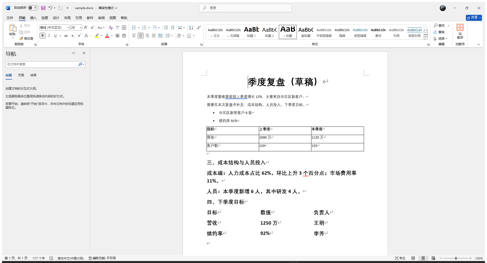
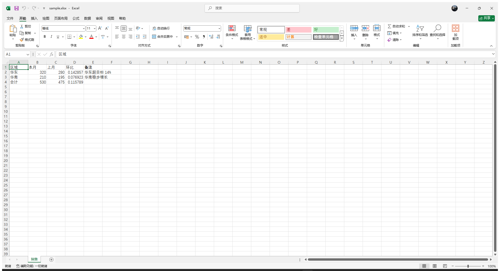
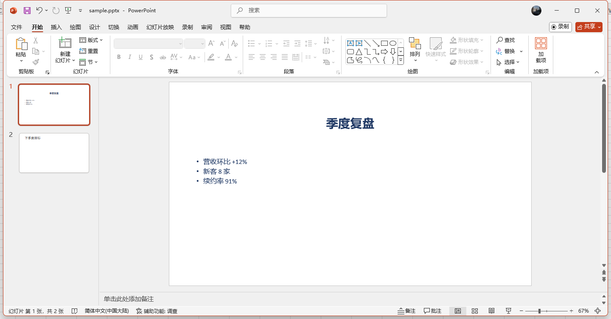

# dsh-office-live

Live Office tools for DeepSeek Harness: read, screenshot and edit **the document the user
currently has open** in Word / Excel / PowerPoint — no file round-trips, no "close and
reopen", the change appears in the window the user is looking at.

Unlike `dsh-office-tools` (which reads and writes `.docx`/`.xlsx`/`.pptx` files), this plugin
attaches to the **running Office application** through COM and works on the live document —
including whatever the user has typed since the file was saved.

## Demo

A live Word window after `office_live_edit` appended two sections and a table — the change is
already on screen, nothing was saved:



Excel: `office_live_read` returned the evaluated formula values, then `excel.set_cell` wrote a
new "备注" column into the open workbook:



PowerPoint: `ppt.set_text` rewrote the bullet list and `ppt.add_slide` added the second slide:



> How it is built (three layers, the JSON bridge, why results go through a UTF-8 side file,
> why edits are not saved by default): **[docs/HOW-IT-WORKS.md](docs/HOW-IT-WORKS.md)** (in Chinese).

## Tools

| Tool | What it does |
| --- | --- |
| `office_live_status` | Which of Word / Excel / PowerPoint is running and which documents are open |
| `office_live_read` | Read live contents as JSON (Word paragraphs + styles, Excel cells with evaluated formulas, PowerPoint shapes) |
| `office_live_shot` | PNG screenshot of the application window (ribbon and page) |
| `office_live_snapshot` | `read` + `shot` in one call — best starting point before editing |
| `office_live_edit` | Batch live edits (paragraphs, find/replace, tables, cells, slides) |
| `office_live_open` | Open a file in the real application so edits are visible on screen |
| `office_live_close` | Close the window (optionally saving) |

`office_live_edit` operations:

- Word — `word.append_paragraph`, `word.insert_paragraph_before`, `word.set_paragraph`,
  `word.replace`, `word.insert_table`, `word.insert_page_break`
- Excel — `excel.set_cell`, `excel.set_range`, `excel.add_sheet`
- PowerPoint — `ppt.set_text`, `ppt.add_slide`

## Requirements

- Windows with a desktop Microsoft Office installation (COM ProgIDs `Word.Application`,
  `Excel.Application`, `PowerPoint.Application`). Tested with Office LTSC 2024.
- Windows PowerShell 5.1+ (`powershell.exe`); override with the `OFFICE_LIVE_POWERSHELL`
  environment variable (for example `pwsh.exe`).
- Maybe counter-intuitive but real Office only. Microsoft Store "Office" stubs and web
  versions expose no COM automation; WPS Office uses different ProgIDs.

## Safety

- Attaches to an **already running** instance; it never creates a hidden copy of a document.
- Edits are **not saved** unless `save: true` is passed, so the user can review the change
  in the window, undo it with Ctrl+Z, or ask for more changes first.
- Word reads are capped at the first 400 paragraphs; Excel reads the active sheet's used
  range up to 200 rows × 40 columns.
- Taking a screenshot brings the window to the foreground (it steals focus for a moment).

## Install

```bash
# from the plugin market UI: add  dsh-office-live
# or from a checkout / tarball:
dsh plugin --profile desktop add ./dsh-office-live-0.1.0.tgz
```

Then restart DSH. The tools appear in every new session.

## How it is wired

`lib/index.js` registers the seven tools with `@deepseek-ai/dsh-tools` and shells out to
`assets/office-live.ps1`, passing `-ResultFile` (a UTF-8 side file, so Chinese text is not
mangled by the Windows console code page). The script does the COM and screenshot work and
prints one JSON object per call.

## License

MIT
