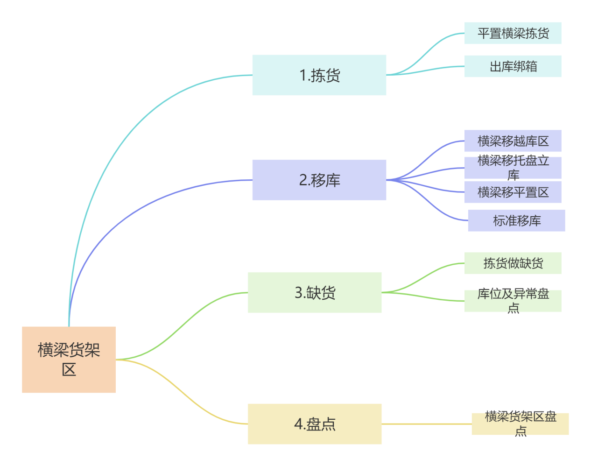

{width="5.753472222222222in"
height="4.5368055555555555in"}

1.  ①横梁货架区拣货：进入手持主页面点击出库点击平置横梁拣货（非设备区用同一个拣货功能）

    ②选择区域选择一层横梁货架区会看到任务类型（包括B2B拣货与加工任务）选择B2B任务

    ③在库位编码位置扫库区起始码申领任务直到申领满15个点击执行拣货

    ④扫描拣货库位、托盘号、核对书号与库存数量，输入需要拣货数量将包件拣到拣货托盘并绑定托盘即可完成拣货

    ⑤出库绑箱扫描托盘号及扫描管理书代号，核对任务数与实拣数量扫描目标容器号绑定周转箱即可投线

2.  ①横梁货架区移库手持主页面点开库存找到分段移库下架区域选择横梁货架区，点击容器号旁边放大镜可以看到需要移库的库位书代号及目标区域，进入之后核对库位容器号及输入书代号确认下架

    ②到达目标区域，进入手持主页面 →
    点击【入库】点击【上架确认】输入容器号、管理书代号 核对库存数量扫描目标库位确认上架成功

    ③打开手持主页面 →
    点击【库存】选择【标准移库】 扫描原始库位、原始容器号核对信息后确认，输入移库数量 扫描目标库位、目标容器号点击确认，完成标准移库

3.  进入手持主页面 →
    点击【出库】→【平置横梁拣货】选择区域：一层横梁货架区任务类型选择：B2B拣货 在库位编码处扫描库区起始码，申领任务，最多申领15个点击【执行拣货】依次扫描：拣货库位、拣货托盘号、拣货书代号，核对库存数量，库存不足时，先把现有数量拣完；剩余数量点击【缺货】，提示缺货成功，点击缺货后，该库位自动管控，系统自动生成此库位的异常盘点单，后续按盘点单处理异常

4.   打开手持主页面 →
    点击【库存】→【非设备区盘点】选择区域：一层横梁货架区，扫描起始码，系统自动推荐盘点库位，点击确认 进入盘点页面，先扫描盘点库位码输入托盘号、管理书代号 清点实物数量，输入准确数量点击确认，提示盘点成功
